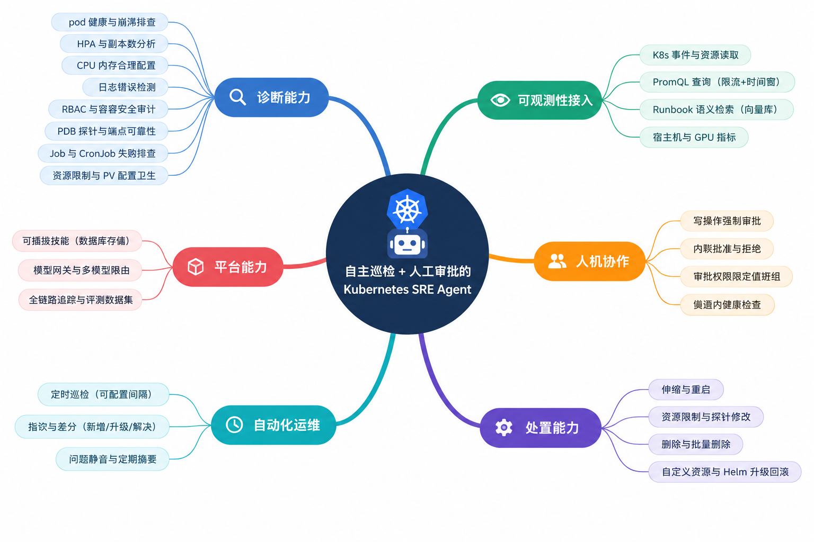
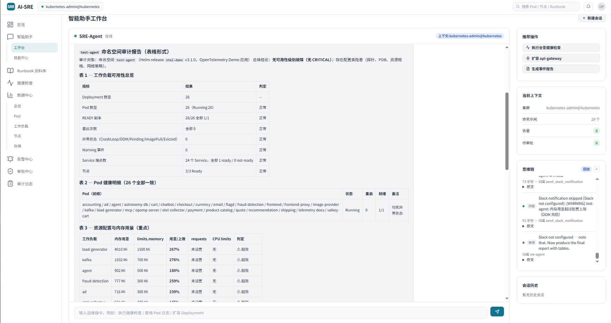
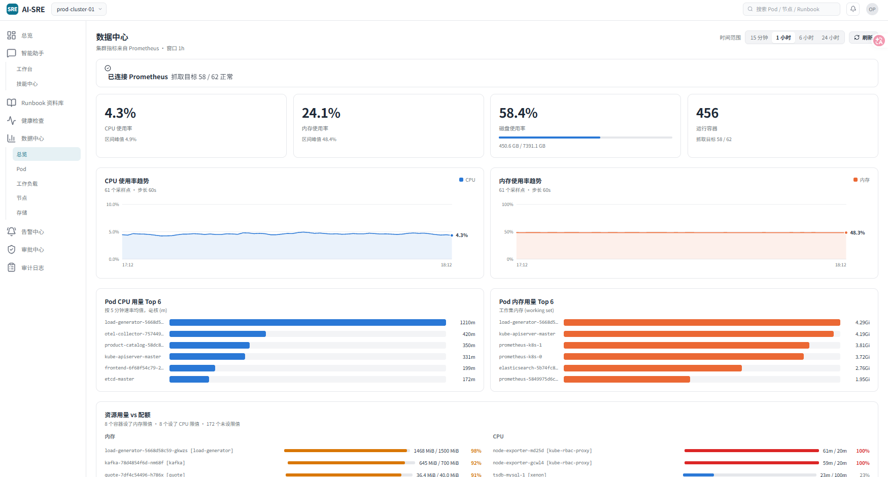
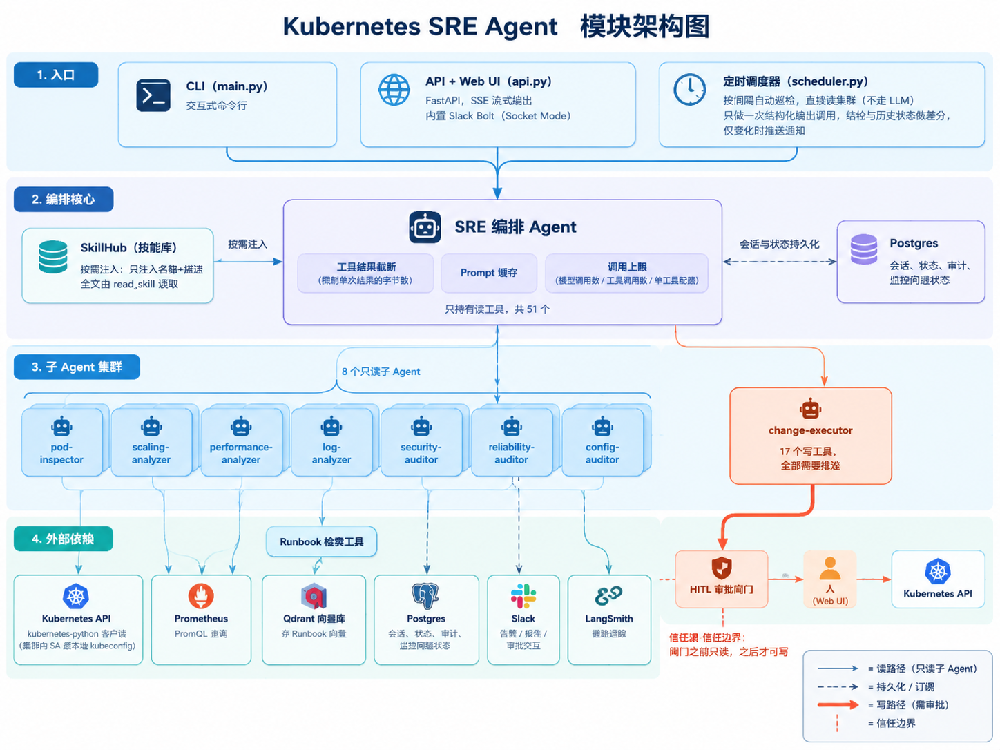
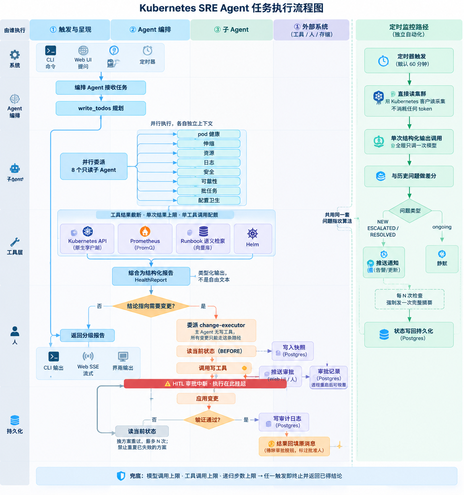

# Kubernetes SRE Agent（AI-SRE 智能运维平台）

自主运行的 Kubernetes SRE Agent：它持续巡检集群、定位故障、给出修复方案，并且**在每一次写操作之前停下来等人批准**。

本项目基于 GitHub 上开源的 SRE Agent 项目二次开发，补齐了可交付的产品化能力——运维控制台、Prometheus 数据中心、Runbook 知识库、告警中心与审计日志、技能库（SkillHub）热插拔，以及更完整的成本与失控防护。

---

## 解决问题

Kubernetes 的日常运维有两个反复出现的痛点：

**一是巡检负担重。** 集群健康状况散落在 pod 状态、事件、日志、指标、RBAC、PDB、探针、配额、HPA 等十几个维度里，人工排查既慢又容易漏。本项目让一个编排 Agent 并行派出 8 个专职只读子 Agent 分头分析，最后汇总成一份**结构化的分级报告**——不是一段自由文本，而是能直接渲染成表格的字段化结论。

**二是自动化与安全相矛盾。** 让 Agent 自主改生产集群风险极大，但只读的 Agent 又解决不了问题。本项目的答案是 **HITL（Human-in-the-loop，人在回路）**：Agent 可以诊断、可以提出修复、可以执行修复，但**每一个写操作都必须经人批准**。编排 Agent 手上根本没有写工具——所有变更都委派给专门的 `change-executor` 子 Agent，而它被配置为**在每次写入前中断**。



*能力地图：诊断、可观测性接入、人机协作、处置、自动化运维、平台能力六个方向。*

---

## 核心设计

### 读写权限分离

编排 Agent **只有读工具**（共 51 个）。所有变更委派给 `change-executor`，它持有 17 个写工具，并且**每一个都挂在 HITL 拦截表上**

### 成本与失控防护

Agent 循环很容易失控。本项目从四个维度设了上限，每一层都对应一次真实发生过的事故

### 结构化输出而非自由文本

健康分析返回类型化的 `HealthReport`（见 `schemas.py`），而不是 markdown 文本

---

## 功能

### 巡检与诊断
- **并行健康巡检** —— 8 个专职只读子 Agent 分头分析 pod 健康、伸缩、资源、日志、安全、可靠性、配置卫生、批处理任务
- **自定义资源（CRD）支持** —— 执行者能增删改 CRD 实例，因此面对 operator 托管的资源，可以删掉顶层 CR 而不是和调谐循环较劲
- **Helm 支持** —— release 检查、values/manifest 读取、版本对比、升级与回滚

### 可观测性数据接入
- **Prometheus 指标** —— `prometheus_query` / `prometheus_query_range` / `prometheus_list_metrics`。考虑到 PromQL 可以让 Prometheus 为**所有共享它的看板**扫描整个时序库，这几个工具做了额外约束：单次运行调用上限、最大时间窗口、单次返回的序列数与点数上限
- **本地 Runbook 检索（RAG）** —— `knowledge/runbooks/` 下的运维手册经多语言 E5 向量化后存入 Qdrant，Agent 通过 `search_knowledge` 按需检索。工具内部固定了相关度阈值，**这个参数刻意不暴露给模型**，否则模型可以传 `min_score=0` 直接绕过它
- **Windows 主机指标** —— 容器外主机的 CPU / 内存 / 磁盘以及 GPU 指标

### 人机协作
- **HITL 审批** —— 每个写操作前暂停等待批准；批准或拒绝后**在同一条消息里回填决定与结果**并移除按钮，避免重复触发
- **内置批准 / 拒绝** —— Web UI 与 Slack 双通道，待审批项持久化，**服务重启后仍可继续处理**
- **快速健康检查** —— 在频道里说一句「跑个健康检查」，走的是和定时任务相同的**有界路径**（直接读集群 + 一次结构化输出调用），几秒返回，且**不可能撞上 Agent 的递归上限**

### 运行形态
- **两种入口** —— CLI（交互式）与 FastAPI + Web UI（可集群内部署）
- **只读运维控制台** —— 控制台只读、变更走审批，页面包含总览、智能助手工作台、技能中心、Runbook 资料库、健康检查、数据中心（总览 / Pod / 工作负载 / 节点 / 存储）、告警中心、审批中心、审计日志
- **可插拔技能（SkillHub）** —— 技能存在数据库里，中间件只把**已启用技能的「名称 + 描述」**注入系统提示，模型需要时再用 `read_skill` 读全文（渐进式披露）。增删改技能**不需要重启服务**
- **模型网关与多模型限流** —— 设置 `ANTHROPIC_BASE_URL` 即可走 LangChain / LangSmith 网关；不设则直连 Anthropic
- **全链路追踪与评测** —— LangSmith 完整链路可观测，附评测数据集与在线评估器

### 定时监控
- 按可配置间隔巡检集群。调度器**直接用 Kubernetes 客户端采集状态（不消耗 token）**，然后只做**一次**结构化输出调用生成结论
- 结论与上次运行做差分，**只在出现新问题、升级或已解决时才推送 Slack**。没有这个差分，一个稳态问题会每个周期重复播报一次——这正是它当初吵到没法看的原因
- 每隔 N 次检查强制推送一次完整报告摘要，让安静的频道也能证明机器人还活着

### 前端效果

**智能助手工作台**：编排 Agent 在线，左侧是对话与结构化报告（可用性总览 / Pod 健康明细 / 资源配置与内存用量），右侧是推荐操作、当前上下文、思维链与会话历史。



**数据中心**：集群指标来自 Prometheus，支持 15 分钟 / 1 小时 / 6 小时 / 24 小时时间范围切换，含 CPU 与内存使用率趋势、Pod 用量 Top 6、资源用量 vs 配额对比。



---

## 架构



```text
main.py / api.py / scheduler.py
    └── SRE 编排 Agent（agent.py）—— 只持有读工具，共 51 个
            ├── pod-inspector        （只读）pod 健康、崩溃、日志
            ├── scaling-analyzer     （只读）HPA、副本数、节点容量
            ├── performance-analyzer （只读）CPU / 内存 合理配置
            ├── log-analyzer         （只读）日志错误检测
            ├── security-auditor     （只读）RBAC、特权容器、NetworkPolicy、镜像标签
            ├── reliability-auditor  （只读）PDB、探针、端点、单副本单点
            ├── job-inspector        （只读）Job、CronJob、失败与漏调度
            ├── config-auditor       （只读）资源限制、PV 卫生、选择器不匹配
            └── change-executor      （写操作 —— 全部需要 HITL 批准）
```

外部依赖：**Kubernetes API**（集群内 SA 或本地 kubeconfig）、**Prometheus**（PromQL 查询）、**Qdrant**（Runbook 向量检索）、**Postgres**（会话、状态、审计、监控问题状态）、**LangSmith**（链路追踪）。

---

## 任务执行流程



**交互式路径（左侧主流程）**

1. **触发与呈现** —— CLI 命令 / Web UI 提问 / 定时器，编排 Agent 接收任务
2. **规划** —— `write_todos` 拆解任务
3. **并行委派 8 个只读子 Agent** —— 各自独立上下文，分头覆盖 pod 健康、伸缩、资源、日志、安全、可靠性、批任务、配置卫生
4. **工具层取证** —— Kubernetes API（原生字段）、Prometheus（PromQL）、Runbook 语义检索（向量库）、Helm
5. **综合为结构化报告** —— 类型化输出 `HealthReport`，不是自由文本
6. **判断是否需要变更**
   - **否** → 返回分级报告，经 CLI 输出 / Web SSE 流式 / 界面输出呈现
   - **是** → 委派 `change-executor`（主 Agent 无写工具，所有变更只能走这条路径）
7. **变更执行与审批**（写路径）
   - 读取当前状态（BEFORE），**写入快照到 Postgres**
   - 调用写工具 → **HITL 审批中断**——执行在此挂起
   - 推送审批到 Web UI / 人，审批记录落 Postgres（**服务重启后可恢复**）
   - 批准后应用变更
   - **验证通过？**
     - **否** → 读取当前状态，换方案重试，最多 N 次，且**禁止重复已失败的方案**
     - **是** → 写审计日志，**结果回填原消息**（附逐条审批结果，标注批准人）

**定时监控路径（右侧独立自动化）**

定时器触发（默认 60 分钟）→ 直接用 Kubernetes 客户端读集群（**不消耗任何 token**）→ 全流程只调**一次**模型做结构化输出 → 与历史问题做差分（与交互路径**共用同一套问题指纹算法**）→ 按问题类型分流：`NEW` / `ESCALATED` / `RESOLVED` 推送通知，`ongoing` 静默 → 每 N 次检查强制发一次完整摘要 → 状态写回持久化（Postgres）。

---

## 快速开始

### 前置条件

- Python 3.12+
- `kubectl` 已配置并指向你的集群（本地开发用）
- Anthropic API Key
- LangSmith API Key（用于链路追踪）
- Slack 应用（可选，需要 Bot Token 与 App-level Token）

### 本地运行

```bash
pip install -r requirements.txt
cp .env.example .env
# 在 .env 里填好各项密钥

python main.py        # CLI 模式
python start.sh       # API + Web UI（端口取自 .env 的 API_PORT）
```

> 如果本机 shell 里设了 SOCKS 代理（`ALL_PROXY`），`httpx` 会尝试使用它，而缺少 `socksio` 包时会**在建立客户端时就崩溃**。`start.sh` 会主动清掉这些代理变量。

### Runbook 检索（可选）

```bash
docker compose -f docker-compose.rag.yml up -d   # 起 Qdrant
python scripts/index_runbooks.py                 # 索引 knowledge/runbooks/
```

未部署时 `search_knowledge` 会返回明确的不可用提示，Agent 会退回仅依赖集群实时证据，**不会中断任务**。

---

## 环境变量

见 `.env.example`，每项都有注释说明用途与默认值。几个关键项：

| 变量 | 说明 |
|---|---|
| `ANTHROPIC_API_KEY` | 必填 |
| `ANTHROPIC_BASE_URL` | 走模型网关时设置；不设则直连 Anthropic |
| `LANGSMITH_API_KEY` | 链路追踪 |
| `DATABASE_URL` | 持久化状态（见下）。**留空则退回内存实现** |
| `DEFAULT_NAMESPACES` | 巡检范围；留空则自动发现所有非系统命名空间 |
| `PROMETHEUS_URL` | Prometheus 地址；留空则仅依赖 metrics-server |
| `SLACK_BOT_TOKEN` / `SLACK_APP_TOKEN` | Slack 集成 |
| `SLACK_APPROVER_IDS` | 限制哪些人有权批准变更；**留空 = 任何能看到消息的人都能批** |
| `TOOL_OUTPUT_MAX_CHARS` | 单个工具结果的最大字节数 |
| `PROTECTED_NAMESPACES` | 拒绝删除操作的命名空间 |

---

## 部署到 Kubernetes

```bash
# 1. 构建并推送镜像
#    更新 k8s/deployment.yaml 里的镜像地址

# 2. 从模板创建密钥文件（切勿提交结果）
cp k8s/secret.yaml.example k8s/secret.yaml
#    模板用 stringData，直接粘明文，不用手动 base64。
#    只有 ANTHROPIC_API_KEY 是必填，其余在 deployment.yaml 里标记为 optional。
#    若改用 data:，务必用 printf 编码——用 echo 会带上换行符，产生一个 API 会拒绝的 token。
#    POSTGRES_PASSWORD 必须是字母数字：deployment.yaml 会把它拼进 DATABASE_URL，
#    出现 / + @ 会破坏 DSN。

# 3. 应用（含支撑持久化状态的 Postgres StatefulSet）
kubectl apply -k k8s/

# 4. 访问 UI
kubectl port-forward -n sre-agent svc/sre-agent 8080:8080
# 打开 http://localhost:8080

# 5. 确认状态是持久化的（而非静默降级到内存）
kubectl port-forward -n sre-agent svc/sre-agent 8080:8080 &
curl -s localhost:8080/health
# => {"state_backend": "postgres", "durable_state": true}
```

### RBAC

Agent 需要一套有边界的权限：读全部资源、写工作负载、以及少量集群级操作（如 `nodes` 的 patch，用于 cordon / uncordon）。见 `k8s/clusterrole.yaml`——**按最小权限原则裁剪后再用到生产**。

---

## 项目结构

```text
agent.py              主 SRE 编排 Agent（工具表、中间件栈、系统提示）
api.py                FastAPI 服务（SSE 流式、HITL 端点、Web UI、运维控制台）
main.py               CLI 入口
config.py             基于环境变量的配置（含各项成本与失控防护参数）
schemas.py            Pydantic 模型（Finding / HealthReport）——结构化输出契约
scheduler.py          定时巡检调度器；结论与历史状态做差分，只推送变化
monitor_state.py      稳定的问题指纹与运行间差分（纯函数）
persistence.py        Postgres checkpointer/store、会话、HITL 审计、问题状态；
                      数据库不可达时退回内存实现并明确告警
slack_notifier.py     Slack Block Kit 消息与 HITL 交互处理
skill_middleware.py   数据库支撑的技能注入中间件 + read_skill 工具（渐进式披露）
demo_data.py          运维控制台面板的演示数据（无真实数据源时的降级展示）
deploy.sh             构建、推送镜像并部署

tools/
  kubernetes_read.py        只读 kubectl 工具（含 kubectl_get_resource：读取资源原始规格）
  kubernetes_write.py       写工具（全部需要 HITL），含批量操作与
                            kubectl_patch_deployment（结构化修改 pod 模板）
  kubernetes_security.py    RBAC、容器安全、NetworkPolicy、镜像标签
  kubernetes_reliability.py PDB、探针、端点、单副本
  kubernetes_hygiene.py     资源限制、PV、选择器不匹配
  kubernetes_batch.py       Job 与 CronJob
  helm.py                   Helm release 检查与升级 / 回滚
  prometheus_tools.py       PromQL 查询（带调用上限、时间窗与序列数限制）
  knowledge.py              本地 Runbook 检索（阈值固定在工具内部）
  windows_host.py           容器外主机与 GPU 指标
  k8s_client.py             集群内 / 本地 kubeconfig 自动识别
  slack.py                  Agent 用的 Slack 通知工具

subagents/
  pod_inspector.py  scaling_analyzer.py  performance_analyzer.py  log_analyzer.py
  security_auditor.py  reliability_auditor.py  job_inspector.py  config_auditor.py
  change_executor.py        唯一持有写工具的子 Agent

rag/
  embeddings.py             多语言 E5 向量化（懒加载；失败时明确报错而非静默）
  vector_store.py           Qdrant 封装
  indexer.py                增量索引
knowledge/runbooks/         运维手册语料
scripts/                    索引与文档构建脚本
sre-agent-ui/               只读运维控制台前端
k8s/                        Kustomize 清单（含 Postgres StatefulSet 与 Secret 模板）
tests/                      pytest（结构、渲染、持久化、工具行为与不变量）
evals/                      LangSmith 评测数据集与在线评估器
```

---

## 持久化状态

Checkpoint、会话、HITL 审计日志与监控问题状态都放在 Postgres（`k8s/postgres.yaml` 在 `sre-agent` 命名空间里起 StatefulSet）。

**没有它会怎样**：一次 pod 重启就会让所有待审批请求搁浅。所以服务启动时会明确打印当前状态：

```text
SRE Bot ready (scheduler=60m, slack=False, state=postgres, approvers=unrestricted)
```

看到 `state=memory` 就说明在**降级运行**——待审批请求重启即丢，审计日志不落盘。

> 注意：降级路径有一个 30 秒的连接池超时。数据库不通时，启动会卡这 30 秒并打印一屏连接失败重试，然后才回退到内存。这是**预期行为，不是卡死**。

---

## 监控行为

调度器按间隔（默认 60 分钟）巡检，产出与人工触发相同的结构化报告。但**只有变化才会推送**：

- **NEW** —— 首次出现
- **ESCALATED** —— 严重度上升
- **RESOLVED** —— 上次有、这次没了
- **ongoing** —— 一直存在，不单独播报

每 `MONITOR_DIGEST_EVERY_N_CHECKS` 次强制发一次完整摘要。Slack 消息上的「Ack」按钮可以把某个问题静音 `MONITOR_ACK_HOURS` 小时。

问题的身份靠**稳定指纹**（`monitor_state.py`）识别——模型换一种措辞、Kubernetes 重建 pod 换了名字，同一个问题仍然会被认成同一个。

---

## 评测

`evals/` 下有基于 LangSmith 的数据集与评估器（严重度准确性、工具覆盖率、LLM-as-judge 质量评分）。

除静态数据集外，本项目的 Agent 还用 **ITBench**（IBM Research 的 IT 自动化基准）SRE 场景评测，涵盖错误镜像、环境变量篡改、探针配置、资源配额、Secret 损坏等 18 类真实故障。评测方法与结果另见评测记录。

